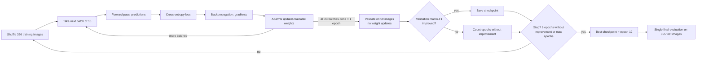
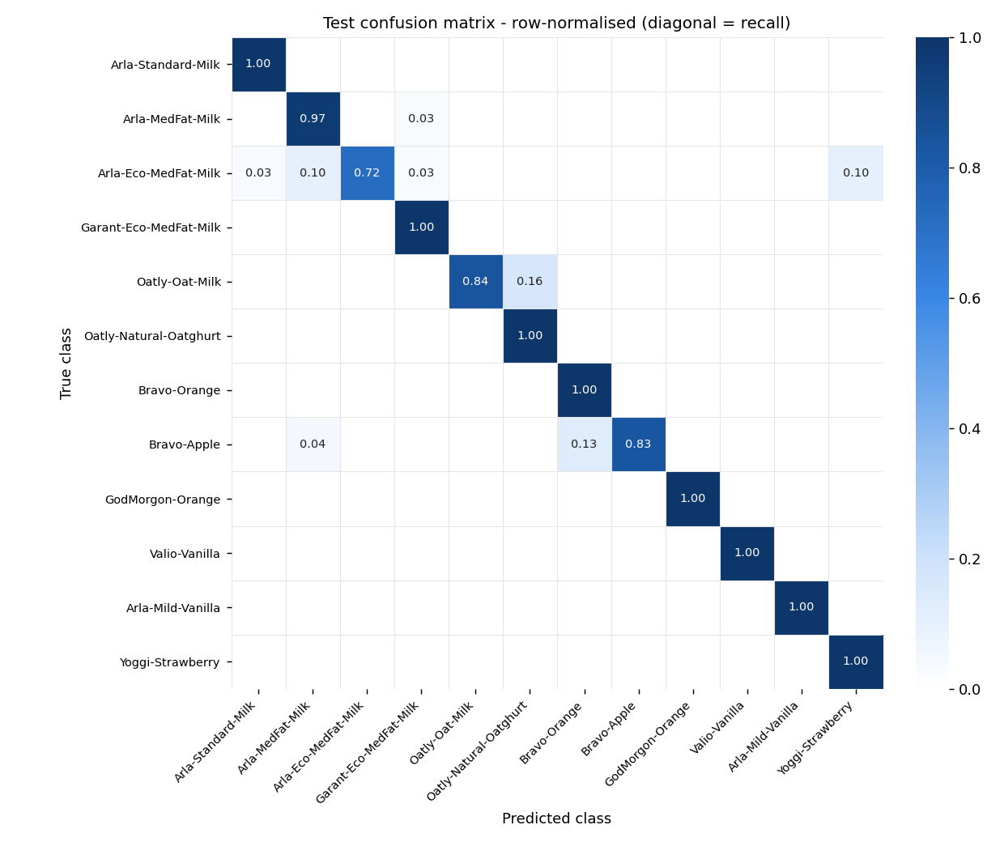
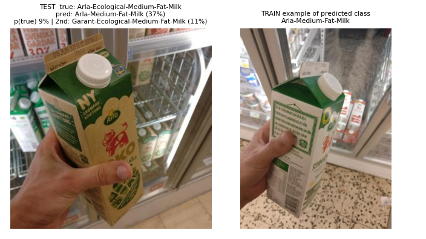
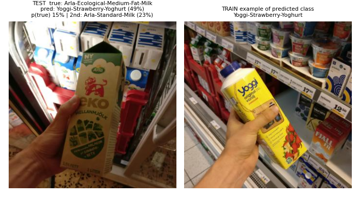

# Retail Product Recognition with MobileNetV3-Small

**Fine-grained recognition of visually similar grocery products using transfer learning (PyTorch).**

This repository is a focused technical prototype prepared for ClearCart. It fine-tunes an
ImageNet-pretrained **MobileNetV3-Small** to recognise **12 packaged grocery products** from
in-store smartphone photos. It also documents how the model was trained and evaluated, where it
fails, and how the approach could be extended to a catalogue of **1,000+ products**.

> **Scope.** This is a 12-class proof of concept built in a time-boxed exercise. It is **not** a
> production system and it does **not** recognise ClearCart's 1,119 products. Section I describes
> how it could scale and labels every item as implemented or proposed.

### Results at a glance

| | Value |
|---|---|
| Test accuracy (355 images, official test split) | **94.9%** (337/355), 95% CI 92.7–97.2% |
| Test macro-F1 | **0.948**, 95% CI 0.925–0.969 |
| Test top-2 accuracy | **98.6%** (350/355) |
| Validation accuracy / macro-F1 (59 images) | **76.3%** (45/59) / 0.717 |
| Training time / peak RAM | 2.4 min on a laptop CPU / 1.35 GB |

> **Read these two accuracies together.** The test images are more visually similar to the training
> images than the validation images are (section G). 94.9% reflects performance under capture
> conditions close to the training data. It is **not** an estimate for new stores, cameras or
> capture sessions, where accuracy is likely to be considerably lower.

---

## Contents

- [A. Project overview](#a-project-overview)
- [B. Dataset](#b-dataset)
- [C. Model architecture](#c-model-architecture)
- [D. Training methodology: Stage 1 and Stage 2](#d-training-methodology-stage-1-and-stage-2)
- [E. Batches, epochs and weight updates](#e-batches-epochs-and-weight-updates)
- [F. Training results](#f-training-results)
- [G. Final test evaluation](#g-final-test-evaluation)
- [H. Error analysis](#h-error-analysis)
- [I. Scaling to 1,000+ products](#i-scaling-to-1000-products)
- [J. Challenges and lessons learned](#j-challenges-and-lessons-learned)
- [K. Reproduction and usage](#k-reproduction-and-usage)
- [L. Project structure and technologies](#l-project-structure-and-technologies)

---

## A. Project overview

**Objective.** Given a photo of a single packaged product, predict which of the registered
products it is.

**Why this is hard.** In a real catalogue the difficult cases are not unrelated items. They are
**sibling products**: the same brand and carton in a different flavour, fat content or product line.
Those products differ only in small details such as a word on the label, a percentage or a colour
accent. Photos are also hand-held, taken at different angles and under store lighting, often in
front of shelves full of similar packaging.

**What this project demonstrates**

- Preparing a fine-grained subset of a public dataset without leakage, using the official splits and
  a duplicate and near-duplicate audit.
- Two-stage transfer learning with a small, efficient CNN (MobileNetV3-Small).
- Validation-based model selection, with a single held-out evaluation on the test set.
- Error analysis focused on visually similar products.
- An honest interpretation of the results, and a concrete plan for scaling to 1,000+ products.

**Technologies:** Python 3.10, PyTorch 1.13.1, torchvision 0.14.1 (MobileNetV3-Small, ImageNet
weights), scikit-learn, NumPy, pandas, Matplotlib, Pillow, ImageHash.

## B. Dataset

**Source:** [Grocery Store Dataset](https://github.com/marcusklasson/GroceryStoreDataset) by
Marcus Klasson, Cheng Zhang and Hedvig Kjellström (*A Hierarchical Grocery Store Image Dataset with
Visual and Semantic Labels*, IEEE WACV 2019), **MIT License**.

- The original dataset has **5,125 smartphone images** in **81 fine-grained classes** (fruit,
  vegetables and packaged products), with official train (2,640) and test (2,485) splits.
- The authors later added an official **validation split** (`val.txt`, 296 images).
- This project uses **12 of the 81 classes**, a total of **780 images**:

| Split | Images | Used for |
|---|---|---|
| Train | **366** | updating model weights |
| Validation | **59** | monitoring training and choosing the checkpoint |
| Test | **355** | one final evaluation |

The 12-class model was trained only on the 366 training images. It was **not** trained on all
5,125 images.

**Why a small, focused subset?** The exercise was time-boxed at about 3–4 hours of development. The
aim was to show a sound method on the hardest part of the problem, which is visually similar
products, rather than to maximise class count. The 12 classes were chosen because they form
**deliberately confusable groups**, and because each class has an official validation split, at
least 23 training images and at least 22 test images.

| Label | Product | Group | Train | Val | Test |
|---|---|---|---|---|---|
| 0 | Arla Standard Milk | milk | 30 | 5 | 30 |
| 1 | Arla Medium-Fat Milk | milk | 34 | 4 | 34 |
| 2 | Arla Ecological Medium-Fat Milk | milk | 29 | 5 | 29 |
| 3 | Garant Ecological Medium-Fat Milk | milk | 35 | 6 | 35 |
| 4 | Oatly Oat Milk | oatly | 32 | 5 | 31 |
| 5 | Oatly Natural Oatghurt | oatly | 33 | 5 | 30 |
| 6 | Bravo Orange Juice | juice | 32 | 5 | 31 |
| 7 | Bravo Apple Juice | juice | 25 | 4 | 23 |
| 8 | God Morgon Orange Juice | juice | 23 | 5 | 22 |
| 9 | Valio Vanilla Yoghurt | yoghurt | 32 | 5 | 31 |
| 10 | Arla Mild Vanilla Yoghurt | yoghurt | 29 | 5 | 27 |
| 11 | Yoggi Strawberry Yoghurt | yoghurt | 32 | 5 | 32 |

The groups test different kinds of similarity: same brand with a different fat label (milk), the
same design language (Oatly), same brand with a different flavour and same flavour with a different
brand (juice), and the same flavour across brands (yoghurt).

**Data integrity.** The official splits were used unchanged: no image was moved, removed,
duplicated or relabelled. Every pair of the 780 images was compared using three signals: SHA-256 of
the file bytes, a perceptual hash, and the similarity of pretrained CNN features. The full report is
in [`results/data_audit/`](results/data_audit/).

| Check | Result |
|---|---|
| Image paths in more than one split | 0 |
| Exact duplicate files | 0 |
| Cross-split near-duplicates (pHash ≤ 6 or feature similarity ≥ 0.95) | **0** |
| Closest cross-split pair | a different photo of the same product on the same shelf (pHash 16, similarity 0.94) |
| Same photo under two different labels | none |
| Images unchanged at the end of the project (re-hashed) | 780 / 780 |
| Burst shots (same carton photographed seconds apart, *within* one split) | train 43 clusters (~315 independent images of 366); test 37 clusters (~308 of 355); val 4 clusters (~54 of 59) |

The images are not stored in this repository. Section K explains how to download exactly the
780 images used.

## C. Model architecture

**MobileNetV3-Small** is a compact convolutional neural network designed for mobile and embedded
devices. It has two parts:

1. **Backbone (feature extractor).** A stack of efficient convolutional blocks that turns a
   224×224 image into a 576-number feature vector. It was **pretrained on ImageNet** (1.2 million
   images, 1,000 everyday object categories such as dogs, cars and cups). From that training it
   already detects edges, textures, shapes, colour patterns and printed text, which are visual
   building blocks that also describe product packaging.
2. **Classifier head.** A small network that turns the feature vector into one score per class.

```
Input image (3 x 224 x 224)
   │
   ▼
Backbone: pretrained convolutional blocks (927,008 parameters, 34 BatchNorm layers)
   │
   ▼  global average pooling → 576-dimensional feature vector
Classifier head:
   Linear 576 → 1024      (pretrained ImageNet weights, kept)
   Hardswish + Dropout(0.2)
   Linear 1024 → 12       (NEW: replaces the original 1024 → 1000 ImageNet layer)
   │
   ▼
12 scores → softmax → probability for each retail product
```

| Part | Parameters |
|---|---|
| Backbone | 927,008 |
| Classifier head (576→1024 + 1024→12) | 603,148 |
| **Total** | **1,530,156** |

**ImageNet classes vs our classes.** The original network outputs scores for 1,000 ImageNet
categories, none of which is "Arla Medium-Fat Milk". Only the **final layer** is replaced, with a new
layer that outputs **12 scores, one per retail product**. That layer starts from random weights.
Everything before it keeps its pretrained ImageNet weights as a starting point (`src/model.py`).

**Why transfer learning?** With roughly 30 training images per product, training a CNN from scratch
would mostly memorise the training photos. Starting from ImageNet features means the model only has
to learn **which existing visual features separate our 12 products**, which is far easier with
little data.

## D. Training methodology: Stage 1 and Stage 2

Training runs in two consecutive stages in a single run (`src/train.py`). Every value below is the
value used in the reported run (`results/training/training_config.json`).

### Stage 1: classifier head training (epochs 1–3)

- **The backbone is frozen.** Its parameters have `requires_grad = False`, so they receive no
  gradient and are **not updated**.
- **The backbone still processes every image.** Each training image still passes through the frozen
  backbone to produce its 576-number feature vector. Freezing stops the backbone from *learning*;
  it does not stop it from *running*.
- **BatchNorm statistics are also frozen.** The backbone is kept in evaluation mode, so its
  BatchNorm running statistics stay at their ImageNet values. The training script copies them
  before Stage 1 and verifies afterwards that they are unchanged (`results/training/training_summary.json`).
- **Only the classifier head is trained:** 603,148 of 1,530,156 parameters.
- 3 epochs, **AdamW**, learning rate **1e-3** (constant).

**Why this stage?** The new 1024→12 layer starts from random weights. If the whole network were
trained immediately, the large, random gradients from that layer would flow into the backbone and
damage its useful pretrained features. Training the head first gives it a sensible starting point
while the backbone stays intact.

### Stage 2: fine-tuning (epoch 4 onwards)

- **The backbone is unfrozen.** All 1,530,156 parameters, backbone and head, are trainable.
- The pretrained weights are **fine-tuned**: adjusted gently towards details that separate our
  products, such as fat-content text and flavour artwork.
- Up to **25 epochs**, **AdamW** with an initial learning rate of **1e-4** (10× lower than Stage 1)
  and **cosine learning-rate decay**. By epoch 18 the rate had decayed to 4.1e-5.
- BatchNorm running statistics are updated (momentum 0.01), so they adapt to store photos.
- **Early stopping** with **patience 6**: training stops if validation macro-F1 does not improve for
  6 consecutive epochs.

**Settings used in both stages:** weight decay **0.01** (AdamW), cross-entropy loss with
**label smoothing 0.1**, batch size **16**, seed **42**.

**Checkpoint selection.** After every epoch the model is evaluated on the validation set. Whenever
**validation macro-F1** improves, with lower validation loss as a tie-breaker, the model is saved to
`checkpoints/best_model.pt`. The best checkpoint came from **epoch 12**. Epochs 13–18 brought no
improvement, so early stopping ended training **after epoch 18**. The test set played no part in
any of this.

**Data augmentation (training images only).** Random rotation (±10°), random crop and rescale
(70–100% of the image), and mild brightness, contrast and saturation changes. There is **no
horizontal flip**, because mirrored label text is unrealistic, and **no hue change**, because colour
separates products such as orange vs green Bravo cartons. Validation and test images are only
resized and centre-cropped to 224×224, deterministically.

## E. Batches, epochs and weight updates

**What is a batch?** The model does not look at all 366 training images at once. It processes them
in small groups called **batches**. The batch size is **16**, so each epoch has **23 batches**:
22 batches of 16 images plus one final batch of 14 (22 × 16 + 14 = 366). Before each epoch the
training images are **shuffled**, so every batch mixes different products.

**What is an epoch?** One epoch is one complete pass over the training data:

- Batch 1: process 16 images, then update the trainable weights.
- Batch 2: process the next 16 images, then update the weights again.
- … continue until all 23 batches have been processed.
- When all 366 training images have been seen once, **one epoch is complete**.

**How are the weights updated?** For each batch:

1. The model receives a batch of 16 images.
2. It makes a prediction for each image: 12 scores turned into probabilities.
3. The **loss function** (cross-entropy) measures how wrong those predictions are.
4. **Backpropagation** calculates, for every trainable weight, how it should change to reduce the loss
   (its gradient).
5. The **optimiser** (AdamW) adjusts the trainable weights by a small step.

The model does **not** create new weights for each batch. It has one fixed set of 1,530,156
parameters, and each step **adjusts the existing trainable ones**:

| | Stage 1 (epochs 1–3) | Stage 2 (epochs 4–18) |
|---|---|---|
| Weights updated | classifier head only | backbone **and** classifier head |
| Updates per epoch | 23 | 23 |
| Updates in the run | 3 × 23 = 69 | 15 × 23 = 345 |

That makes **414 weight updates** in total.

**What happens after each epoch?** Validation runs **once per epoch, after training on all 23
batches**, not after every batch. All 59 validation images are scored with gradients switched off,
so **validation images never update the weights**. Their only roles are to monitor progress and to
decide which epoch's weights to keep. The **test set** is kept completely separate and was used once,
at the very end.



## F. Training results


| Epochs | Stage | Validation accuracy | Validation macro-F1 |
|---|---|---|---|
| 1–3 | head only | 31 → 35 / 59 | 0.47 → 0.51 |
| 4–5 | fine-tuning | 43 → 45 / 59 | 0.68 → 0.72 |
| 6–18 | fine-tuning | 43–45 / 59 (plateau) | 0.68–0.72 |

- **Training time:** 2.4 minutes on CPU (about 8 seconds per fine-tuning epoch), peak RAM 1.35 GB.
- **Early stopping** ended training after epoch 18. **The best checkpoint is from epoch 12:**
  validation accuracy **76.3%** (45/59), validation macro-F1 **0.717**, validation loss 0.927.
- **Fine-tuning mattered.** Frozen ImageNet features reached about 59% validation accuracy; adapting
  the backbone added about 17 points.
- **Overfitting.** Training accuracy reached **100% by epoch 7**, while validation accuracy stayed
  around 73–76%. Validation loss was lowest at epochs 6–7 (0.824) and then rose to 1.03, meaning
  the model kept becoming more confident on training images without improving on new ones. With
  ~30 training images per class, about 26 of them independent once burst shots are accounted for,
  this is expected.
- **Noisy checkpoint selection.** Epochs 5, 6, 8, 11, 12 and 16–18 all scored 45/59. Epoch 12 won by
  a fourth-decimal macro-F1 difference. The selection rule was fixed before training and was not
  changed after seeing the results.

## G. Final test evaluation

The test set was evaluated **exactly once** by `src/evaluate.py`, using the epoch-12 checkpoint.
The checkpoint's SHA-256 was recorded before and after, and is unchanged. No threshold,
hyperparameter, preprocessing choice or checkpoint was selected using test results.

| Metric | Value | 95% bootstrap CI |
|---|---|---|
| Test images | 355 | |
| Correct predictions | 337 (18 errors) | |
| Accuracy | **0.949** | 0.927 – 0.972 |
| Macro precision | **0.957** | 0.943 – 0.974 |
| Macro recall | **0.947** | 0.925 – 0.967 |
| Macro-F1 | **0.948** | 0.925 – 0.969 |
| Top-2 accuracy | **0.986** (350/355) | |

The intervals use 2,000 percentile-bootstrap resamples. Accuracy uses an ordinary bootstrap; the
macro metrics use a **stratified** bootstrap, which resamples within each class so all 12 classes
appear in every resample. Top-2 accuracy is computed from `results/metrics/test_predictions.csv`.

**Per-class results** ([`results/metrics/classification_report.csv`](results/metrics/classification_report.csv)):

| Product | Precision | Recall | F1 | Test images |
|---|---|---|---|---|
| Arla Standard Milk | 0.968 | 1.000 | 0.984 | 30 |
| Arla Medium-Fat Milk | 0.892 | 0.971 | 0.930 | 34 |
| **Arla Ecological Medium-Fat Milk** | 1.000 | **0.724** | **0.840** | 29 |
| Garant Ecological Medium-Fat Milk | 0.946 | 1.000 | 0.972 | 35 |
| **Oatly Oat Milk** | 1.000 | **0.839** | 0.912 | 31 |
| Oatly Natural Oatghurt | 0.857 | 1.000 | 0.923 | 30 |
| Bravo Orange Juice | 0.912 | 1.000 | 0.954 | 31 |
| **Bravo Apple Juice** | 1.000 | **0.826** | 0.905 | 23 |
| God Morgon Orange Juice | 1.000 | 1.000 | 1.000 | 22 |
| Valio Vanilla Yoghurt | 1.000 | 1.000 | 1.000 | 31 |
| Arla Mild Vanilla Yoghurt | 1.000 | 1.000 | 1.000 | 27 |
| Yoggi Strawberry Yoghurt | 0.914 | 1.000 | 0.955 | 32 |



Raw counts: [`confusion_matrix.png`](results/confusion_matrices/confusion_matrix.png) and
[`confusion_matrix.csv`](results/confusion_matrices/confusion_matrix.csv).

### Why 94.9% should not be read as performance on new stores

Validation accuracy was **76.3%** and test accuracy **94.9%**. The gap matters:

1. **Validation is imprecise.** 45/59 correct has a 95% confidence interval of roughly **64–85%**.
2. **Test images look more like the training images.** For each validation and test image, the
   similarity of its pretrained CNN features to its *nearest training image* was measured. The
   median is **0.881 for test vs 0.848 for validation**, and test is higher **in every one of the 12
   classes**. Training and test photos appear to share store visits and shelves. The validation split
   was added to the dataset later and looks like a separate capture session.
3. **Burst shots.** The test set contains clusters of near-identical shots (~308 independent
   images of 355), so the bootstrap intervals above are **somewhat optimistic**.

**Conclusion.** 94.9% is a fair measure of performance on photos taken under conditions similar to
the training photos. It may **overestimate** performance in genuinely new retail environments, such
as other stores, cameras, lighting or packaging. A test set collected from new capture sessions
would be needed to measure that. This evidence is consistent but indirect.

## H. Error analysis

`src/error_analysis.py` reads the saved test predictions (it never re-runs the model) and writes
the misclassified list, the confusion pairs and example images to
[`results/error_analysis/`](results/error_analysis/).

**17 of the 18 errors come from three products:**

| Product | Errors | Recall |
|---|---|---|
| Arla Ecological Medium-Fat Milk | 8 / 29 | 72.4% |
| Oatly Oat Milk | 5 / 31 | 83.9% |
| Bravo Apple Juice | 4 / 23 | 82.6% |
| Arla Medium-Fat Milk | 1 / 34 | 97.1% |

| True product → predicted as | Count |
|---|---|
| Oatly Oat Milk → Oatly Natural Oatghurt | 5 |
| Arla Eco Medium-Fat → Arla Medium-Fat | 3 |
| Arla Eco Medium-Fat → Yoggi Strawberry Yoghurt | 3 |
| Bravo Apple → Bravo Orange | 3 |
| Arla Eco Medium-Fat → Arla Standard / Garant Eco Medium-Fat | 1 + 1 |
| Arla Medium-Fat → Garant Eco Medium-Fat | 1 |
| Bravo Apple → Arla Medium-Fat | 1 |

**12 of 18 errors are between products of the same brand, and 14 of 18 within the same product
group.**

Each image shows a misclassified test photo (left) next to a training photo of the product it was
confused with (right):

| | |
|---|---|
|  |  |
|  |  |

**What the mistakes reveal.** These are interpretations of the images and statistics, not proven
causes.

- **Oatly Oat Milk vs Oatghurt: shared brand design.** Both cartons use Oatly's black-and-white
  typography and illustration style; the product name is the main difference. This includes the
  most confident error of all (85%).
- **Arla Eco vs Arla Medium-Fat: product variants.** Both are medium-fat milk (*mellanmjölk*) from
  the same brand. The distinguishing eco artwork and colour change with angle and lighting.
- **Bravo Apple vs Bravo Orange: same carton, different flavour.** They share the carton shape,
  the yellow cap and the shelf; colour is the main cue.
- **Arla Eco → Yoggi: presentation and background.** The carton is held at an angle in front of busy
  red, white and blue shelves, and the model was unsure (31–49% confidence).
- **The hardest product has the least typical test photos.** Arla Eco's test images are the least
  similar to its own training images of all 12 classes, which fits with its low recall.

**Confidence is informative but not calibrated.** Correct predictions averaged 72% confidence and
errors 43%; only 1 of 18 errors exceeded 80%. In **13 of 18 errors the correct product was the
model's second choice**, which is why top-2 accuracy is 98.6%. Raw softmax scores are not
calibrated probabilities, and label smoothing keeps them moderate by design.

## I. Scaling to 1,000+ products

This project is a **12-class proof of concept**. It has **not** been trained on, or tested against,
ClearCart's 1,119 products. This section explains how the approach would scale.

### Implemented here vs proposed

| Implemented in this repository | Proposed future work (not implemented) |
|---|---|
| 12-class MobileNetV3-Small classifier, two-stage transfer learning | Classifier and/or retrieval system covering all registered SKUs |
| Official splits; duplicate and near-duplicate audit (SHA-256, pHash, CNN features) | Data collection across stores, cameras, sessions and packaging versions |
| Validation-based checkpoint selection; single test evaluation with bootstrap CIs | Evaluation on unseen stores and cameras; latency measurement; production monitoring |
| Confusion-matrix and confusion-pair error analysis | Hard-negative mining driven by confusion pairs |
| Full 12-class probability output per image (`src/predict.py`); top-2 accuracy reported | Top-k candidate interface with validated thresholds and human confirmation |
| Pretrained-feature similarity, used **only** for the data audit | Embedding model and nearest-neighbour product retrieval (e.g. FAISS) |

### 1. Expand and improve the dataset

The errors here come from variety, not model capacity, so data is the first lever.
- Collect images for **every registered SKU**, from multiple views and orientations, under different
  lighting, backgrounds and camera types, including the checkout's own cameras.
- Include **packaging versions**, since products are redesigned and run seasonal editions.
- Collect **extra examples for visually similar products** (sibling SKUs), where errors concentrate.
- Limit burst shots and track the number of *independent* captures per SKU.
- **Split by capture session, store or camera**, never randomly, so test results reflect new
  conditions. This is the issue section G exposes.

### 2. Train a larger product classifier

- Expand the output layer to the full catalogue, starting from a suitable pretrained backbone. A
  larger one than MobileNetV3-Small may be justified if the latency budget allows.
- Measure **class imbalance and rare products**; use class-aware sampling or loss weighting where
  needed, and report **macro** metrics so rare SKUs count.
- Consider **hierarchical classification** (category → brand → SKU), which gives useful partial
  answers and lets specialised models focus on hard sub-groups.

### 3. Use image embeddings for product retrieval

A network can turn any image into an **embedding**: a vector of numbers placed so that photos of the
same product end up close together and different products far apart. It is trained with
metric-learning objectives such as triplet or ArcFace-style losses.
- Store **reference embeddings** for every registered product, from several images each.
- At checkout, compute the embedding of the incoming image and **compare it with the catalogue**.
- Retrieve the **most similar products** with nearest-neighbour search, using a vector index such as
  **FAISS** for speed at scale.
- Return **top-k candidates** rather than a single forced answer.

**Why this helps a changing catalogue:** adding a new product means adding its reference embeddings
to the index, not retraining a classifier whose output layer has a fixed size. A distance threshold
also gives a natural **"unknown product"** outcome, which a closed-set softmax classifier cannot
provide.

### 4. Handle visually similar products

- **Hard-negative mining:** use confusion pairs like those in section H to deliberately train on the
  most confusable pairs.
- **Fine-grained techniques:** higher input resolution or crops of the label area, where the
  distinguishing text is.
- **Better reference images** for sibling SKUs, covering the views where they differ.
- **Top-k comparison:** when the top candidates are siblings, a second, specialised check can decide.
- **Additional verification** for uncertain cases, for example barcode or weight where available.

### 5. Confidence and human confirmation

- Define **confidence thresholds on validation data**, never on test data.
- Accept predictions automatically **only where validation shows that is safe**.
- For ambiguous cases, show the **top 2–3 candidates** for a quick confirmation. Here the correct
  product was second choice in 13 of 18 errors.
- Do not treat raw softmax scores as calibrated probabilities. Calibrate them (e.g. temperature
  scaling on validation data) and monitor calibration over time.

### 6. Production evaluation

- Test on **unseen stores and cameras**, and report results per store and per camera.
- Measure **accuracy, macro-F1, top-k accuracy, per-SKU recall and inference latency** on the target
  hardware.
- **Monitor drift**: low-confidence rates, manual corrections, and new or redesigned products.
- **Update the catalogue or retrain** when packaging changes, and re-evaluate the affected
  confusable groups each time.

### When a single classifier is no longer enough

A single softmax classifier becomes hard to maintain when the catalogue changes often, when many
SKUs have very few images, or when the system must say "this is not a registered product". At that
point **embedding-based retrieval** is the better core. If images contain **several products**, or
the product is small in a cluttered scene, a **detection + recognition** pipeline is needed: first
locate each item, then classify or retrieve each crop. This project covers only the recognition
step.

## J. Challenges and lessons learned

| Challenge | How it was investigated or handled |
|---|---|
| **Limited data per class** (~30 training images, ~26 independent) | Transfer learning from ImageNet; head-first training; augmentation; label smoothing; weight decay; early stopping |
| **Similar-looking products** | Classes chosen in confusable groups; confusion-pair analysis showing 12/18 errors are same-brand; side-by-side error images |
| **Overfitting** | Monitored train vs validation curves; early stopping; one fixed configuration with no tuning on 59 validation images; overfitting documented in section F |
| **Validation vs test conditions** | Measured nearest-training-image similarity per split and per class; reported both accuracies; 94.9% explicitly not presented as new-store performance |
| **Dataset integrity** | Official splits only; exact, perceptual and CNN-feature duplicate checks; final re-hash audit; burst-shot clustering |
| **Small, selected subset** | Bootstrap CIs (stratified for macro metrics) with the burst-shot caveat; per-class results; limitations stated |
| **GPU not usable** (RTX 3050, driver 511.65) | cuDNN failed to initialise on this machine; diagnosed with `src/check_env.py`; trained on CPU (2.4 min) rather than changing the system driver |

**Main lessons**
- For fine-grained retail recognition, **data diversity and evaluation design matter more than
  architecture**. The same model scored 76% or 95% depending on how similar the evaluation photos
  were to the training photos.
- **Sibling SKUs are the core difficulty.** At 1,000+ products they become the main source of error,
  so data collection and hard-negative mining should target them.
- **Confidence and top-k are operationally valuable.** Most errors are low-confidence, and the correct
  answer is usually second choice.

## K. Reproduction and usage

Tested on Windows 11 with Python 3.10. Commands are for PowerShell, run from the repository root.
On Linux or macOS, use `source .venv/bin/activate`, `/` in paths, and
`git -C data/GroceryStoreDataset sparse-checkout set --no-cone --stdin < data/sparse_paths.txt` for
the image download step.

### 1. Install

```powershell
py -3.10 -m venv .venv
.\.venv\Scripts\Activate.ps1           # if blocked: Set-ExecutionPolicy -Scope Process Bypass
python -m pip install --upgrade pip
pip install -r requirements.txt        # CPU build of PyTorch 1.13.1 (Python 3.10 required)
python -m src.check_env                # prints versions, RAM, and runs GPU tests if CUDA is present
```

### 2. Prepare the dataset (downloads only the 780 images used)

```powershell
git clone --filter=blob:none --no-checkout --depth 1 https://github.com/marcusklasson/GroceryStoreDataset.git data\GroceryStoreDataset
git -C data\GroceryStoreDataset sparse-checkout set --no-cone "/dataset/*.txt" "/dataset/classes.csv" "/LICENSE" "/README.md"
git -C data\GroceryStoreDataset checkout
python -m src.prepare_data --counts-only      # exact counts and split checks; writes data\sparse_paths.txt
Get-Content data\sparse_paths.txt | git -C data\GroceryStoreDataset sparse-checkout set --no-cone --stdin
python -m src.prepare_data                    # verifies every image; writes data\manifest.csv
python -m src.check_duplicates                # report-only duplicate analysis
```

### 3. Get the trained checkpoint

Download **[`best_model.pt`](https://github.com/souleimen284/retail-product-recognition/releases/download/v1.0/best_model.pt)** (about 6.3 MB, from the [v1.0 release](https://github.com/souleimen284/retail-product-recognition/releases/tag/v1.0)) and place
it in `checkpoints/`. See [`checkpoints/README.md`](checkpoints/README.md) for the SHA-256 checksum.
The checkpoint is deliberately not stored in git history.

```powershell
Invoke-WebRequest -Uri https://github.com/souleimen284/retail-product-recognition/releases/download/v1.0/best_model.pt -OutFile checkpoints\best_model.pt
```

### 4. Run inference on an image

```powershell
python -m src.predict data\GroceryStoreDataset\dataset\val\Packages\Juice\Bravo-Apple-Juice\Bravo-Apple-Juice_001.jpg
python -m src.predict path\to\your_image.jpg --json     # JSON output
```

Actual output for the validation image above:

```
Predicted : Bravo-Apple-Juice  (43.2%)
All classes:
  Bravo-Apple-Juice                     43.2%
  Yoggi-Strawberry-Yoghurt              13.0%
  Arla-Standard-Milk                    10.2%
  Oatly-Natural-Oatghurt                 8.4%
  ...                                    (all 12 classes, highest first)
```

### 5. Checks, training and evaluation

```powershell
python -m src.smoke_test       # 7 pipeline checks: label mapping, splits, augmentation, determinism,
                               # data loading, model, checkpoint save/load + prediction (no real training)
python -m src.audit_data       # read-only data-integrity audit
python -m src.train            # retrain (~2-3 min on a 6-core CPU); writes checkpoints\best_model.pt
python -m src.evaluate         # ONE-TIME test evaluation (see note)
python -m src.error_analysis   # confusion pairs and example images from the saved predictions
```

- The defaults of `src.train` match the reported run (section D). The Windows runner
  `scripts\train.cmd` additionally refuses to overwrite an existing checkpoint.
- `src.evaluate` **refuses to run if `results/metrics/test_predictions.csv` exists**, which protects
  the one-time test evaluation. The file is included in this repository, so move it aside
  deliberately before re-evaluating.
- On Windows, `scripts/` contains double-click runners for the same steps (`prepare_data.cmd`,
  `run_checks.cmd`, `train.cmd`, `evaluate.cmd`). Each writes a log to `results/logs/`.
- Results are deterministic on the same machine and software versions. Other hardware or library
  builds can produce slightly different numbers.

## L. Project structure and technologies

```
retail-product-recognition/
├── README.md
├── requirements.txt            # pinned dependencies (CPU PyTorch 1.13.1, Python 3.10)
├── requirements-lock.txt       # full pip freeze of the environment used for the reported run
├── .gitignore
├── src/
│   ├── config.py               # paths, the 12 classes and their label order, seed, thresholds
│   ├── prepare_data.py         # data: parse official splits, exact counts, image verification
│   ├── check_duplicates.py     # data: SHA-256 / perceptual-hash / CNN-feature duplicate report
│   ├── audit_data.py           # data: final read-only integrity audit
│   ├── dataset.py              # data: Dataset, train/eval transforms, DataLoaders
│   ├── model.py                # model: MobileNetV3-Small, head replacement, freezing, checkpoints
│   ├── train.py                # training: two-stage fine-tuning with validation-based selection
│   ├── evaluate.py             # evaluation: one-time test metrics, bootstrap CIs, confusion matrices
│   ├── error_analysis.py       # evaluation: misclassifications, confusion pairs, examples
│   ├── predict.py              # inference: single-image prediction
│   ├── smoke_test.py           # pipeline checks
│   └── check_env.py            # environment and GPU diagnostics
├── scripts/                    # Windows runners: prepare_data, run_checks, train, evaluate
├── data/
│   ├── README.md               # dataset source, license, download steps
│   ├── manifest.csv            # the 780 selected images: split, path, class, label
│   └── sparse_paths.txt        # folders fetched by the sparse checkout
├── results/
│   ├── metrics/                # metrics.json, classification_report.csv, test_predictions.csv
│   ├── confusion_matrices/     # raw and row-normalised confusion matrices (.png, .csv)
│   ├── training/               # training curves, per-epoch history, run config and summary
│   ├── error_analysis/         # misclassified.csv, confusion pairs, error_summary.json, examples/
│   └── data_audit/             # split counts, dataset summary, integrity audit, duplicates/
└── checkpoints/
    └── README.md               # how to obtain best_model.pt (GitHub Release asset)
```

`src/` is kept flat because the project has 12 modules with descriptive names; the grouping is
shown in the comments. Configuration lives in `src/config.py` and in the command-line arguments of
`src/train.py`. The values used are saved in `results/training/training_config.json`.

**Technologies (all verified in the code):** Python 3.10 · PyTorch 1.13.1 · torchvision 0.14.1
(MobileNetV3-Small, ImageNet weights) · scikit-learn (metrics) · NumPy · pandas · Matplotlib
(figures) · Pillow (image loading) · ImageHash (perceptual hashing) · psutil (memory logging).

---

**Dataset credit:** Grocery Store Dataset © 2019 Marcus Klasson, MIT License. The figures in
`results/` contain crops of dataset images, which the MIT license permits with this attribution.
**Code license:** not yet specified; it will be chosen by the author.
