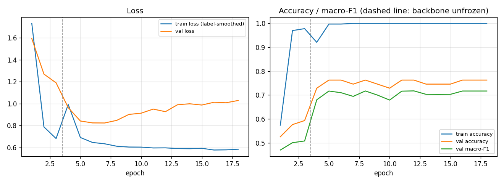
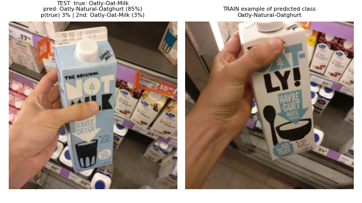
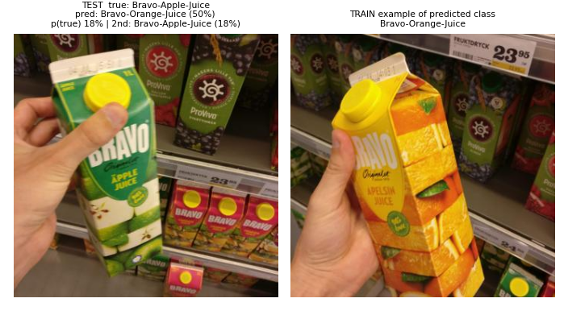

# Retail Product Recognition with MobileNetV3-Small

A small computer vision project on recognising visually similar grocery products from photos.
I fine-tuned an ImageNet-pretrained MobileNetV3-Small on 12 packaged products from the Grocery
Store Dataset, evaluated it on the official test split, looked at where it fails, and wrote up how
I would extend the approach to a catalogue of 1,000+ products.

This is a 12-class prototype, not a system trained on a full product catalogue.

## Dataset

I used the [Grocery Store Dataset](https://github.com/marcusklasson/GroceryStoreDataset)
(Klasson et al., WACV 2019, MIT license). It has 5,125 smartphone photos of 81 product classes
taken in grocery stores, with official train/test splits and a validation split added later.

I picked 12 packaged products that are easy to confuse with each other, for example the same brand
in a different flavour or fat content:

| Group | Products |
|---|---|
| Milk | Arla Standard, Arla Medium-Fat, Arla Ecological Medium-Fat, Garant Ecological Medium-Fat |
| Oatly | Oat Milk, Natural Oatghurt |
| Juice | Bravo Orange, Bravo Apple, God Morgon Orange |
| Yoghurt | Valio Vanilla, Arla Mild Vanilla, Yoggi Strawberry |

That gives 780 images: **366 train, 59 validation, 355 test**. I kept the official splits as they
are and checked them for overlap (exact file hashes, perceptual hashes and CNN feature similarity).
No image appears in more than one split.

## Approach

**Model.** MobileNetV3-Small from torchvision with ImageNet weights (1.53M parameters). I kept the
pretrained backbone and replaced only the last layer (1024 → 1000 ImageNet classes) with a new
1024 → 12 layer for the products. With around 30 training images per product, starting from
pretrained features is much more practical than training from scratch.

**Training in two stages.**

1. *Head only (3 epochs).* The backbone is frozen. Images still go through it to produce features,
   but its weights and BatchNorm statistics are not updated. Only the classifier is trained
   (AdamW, lr 1e-3). This gets the new layer to a reasonable state before touching the backbone.
2. *Fine-tuning (up to 25 epochs).* The whole network is unfrozen and trained with a lower learning
   rate (AdamW, lr 1e-4 with cosine decay). Early stopping with patience 6.

Both stages use weight decay 0.01, label smoothing 0.1 and batch size 16. With 366 training images
that is 23 batches per epoch (22 × 16 + 14), so 23 weight updates per epoch. After each epoch the
model is evaluated on the validation set (no weight updates), and the checkpoint with the best
validation macro-F1 is kept. The test set is not used during training.

Augmentation on training images: small rotations, random crops and mild brightness/contrast
changes. I did not use horizontal flips (mirrored text on packages is unrealistic) or hue shifts
(colour is what separates products like Bravo Orange and Bravo Apple).

## Results

Training took about 2.4 minutes on a laptop CPU. Early stopping ended it after epoch 18, and the
best checkpoint was from epoch 12.



| | Validation (59 images) | Test (355 images) |
|---|---|---|
| Accuracy | 76.3% | 94.9% (337/355) |
| Macro-F1 | 0.717 | 0.948 |
| Macro precision / recall | | 0.957 / 0.947 |
| Top-2 accuracy | | 98.6% |

95% bootstrap intervals on the test set: accuracy 92.7–97.2%, macro-F1 0.925–0.969.

A few things are worth noting about these numbers:

- **The model overfits.** Training accuracy reached 100% by epoch 7, while validation accuracy
  stayed around 75%.
- **The gap between validation and test is large.** When I compared each image with its most
  similar training image (using pretrained CNN features), test images turned out to be noticeably
  closer to the training set than validation images (median similarity 0.881 vs 0.848, and higher
  for every class). The train and test photos seem to come from the same store visits, while the
  validation set looks like a separate capture session. So 94.9% describes performance in familiar
  conditions. I would expect results in a new store or with a different camera to be closer to the
  validation number.
- Some images are burst shots of the same item taken seconds apart, which makes the confidence
  intervals somewhat optimistic.


### Where it goes wrong

17 of the 18 test errors come from three products: Arla Ecological Medium-Fat (8), Oatly Oat Milk
(5) and Bravo Apple (4). Most mistakes are between products of the same brand:

- Oatly Oat Milk → Oatly Oatghurt (5): same design style, mainly the product name differs.
- Arla Ecological → Arla Medium-Fat (3): both medium-fat milk, the eco artwork is the main difference.
- Bravo Apple → Bravo Orange (3): same carton and cap, colour is the main cue.

| | |
|---|---|
|  |  |

*Misclassified test image (left) next to a training image of the predicted product (right).*

Most errors had low confidence (average 43%, against 72% for correct predictions), and in 13 of the
18 errors the correct product was the second choice.

## Scaling to 1,000+ products

The main thing this experiment showed is that the hard part is not telling different categories
apart, but separating sibling products of the same brand, and that the evaluation setup can make a
big difference to the numbers. With 1,119 products there would be many more of these sibling
groups. This is how I would approach it:

**Data first.** Collect images for every SKU from several angles, lighting conditions, stores and
cameras, including the checkout cameras themselves and different packaging versions. Put extra
effort into products that look alike. Split train and test by store, camera or capture session
rather than randomly, so the test score reflects new conditions. The validation/test gap above is
an example of what happens otherwise.

**Classifier at full scale.** Extend the output layer to the full catalogue, possibly with a larger
backbone if the latency budget allows. Use class-balanced sampling or loss weighting for rare
products, and report macro-F1 and per-SKU recall so small classes are not hidden by the average.
A hierarchy (category → brand → SKU) is also worth considering.

**Embedding-based retrieval.** For a catalogue that changes often, I would train the network to
produce an embedding (a feature vector) per image instead of a fixed set of class scores. Each
registered product gets reference embeddings, and a new image is matched with nearest-neighbour
search (for example with FAISS). Adding a product then means adding its reference images rather
than retraining, and a distance threshold gives an "unknown product" answer that a plain
classifier cannot give.

**Similar-looking products.** Use the confusion matrix to find confusable pairs and train on them
more (hard-negative mining), use higher resolution or crops of the label area where the text
differs, and add a second check when the top candidates are siblings.

**Confidence and confirmation.** Here most errors were low-confidence and the right answer was
usually second. A checkout could accept confident predictions automatically and show the top 2–3
candidates otherwise. The threshold should be set on validation data, and the scores calibrated,
because raw softmax values are not reliable probabilities.

**Production evaluation.** Test on unseen stores and cameras, track accuracy, macro-F1, top-k
accuracy, per-SKU recall and inference latency, and monitor low-confidence rates and corrections
over time so new or redesigned products are caught.

If images contain several products at once, a detection step would be needed before recognition.
This project only covers the recognition part.

## Running the code

Requires Python 3.10.

```powershell
py -3.10 -m venv .venv
.\.venv\Scripts\Activate.ps1
pip install -r requirements.txt
```

Download only the 12 classes used (see [`data/README.md`](data/README.md)):

```powershell
git clone --filter=blob:none --no-checkout --depth 1 https://github.com/marcusklasson/GroceryStoreDataset.git data\GroceryStoreDataset
git -C data\GroceryStoreDataset sparse-checkout set --no-cone "/dataset/*.txt" "/dataset/classes.csv" "/LICENSE" "/README.md"
git -C data\GroceryStoreDataset checkout
python -m src.prepare_data --counts-only
Get-Content data\sparse_paths.txt | git -C data\GroceryStoreDataset sparse-checkout set --no-cone --stdin
python -m src.prepare_data
```

Trained model: download [`best_model.pt`](https://github.com/souleimen284/retail-product-recognition/releases/download/v1.0/best_model.pt) (6.3 MB) into `checkpoints/`.

```powershell
python -m src.predict path\to\image.jpg      # predicted product and probabilities
python -m src.train                           # retrain (~2-3 min on CPU)
python -m src.evaluate                        # test evaluation (refuses to overwrite existing results)
python -m src.error_analysis                  # confusion pairs and error examples
```

## Project structure

```
src/
  config.py            classes, paths, settings
  prepare_data.py      split parsing, counts, image checks
  check_duplicates.py  duplicate / near-duplicate check across splits
  dataset.py           data loading and augmentation
  model.py             MobileNetV3-Small with the new 12-class head
  train.py             two-stage training
  evaluate.py          test metrics, confusion matrices, bootstrap intervals
  error_analysis.py    misclassifications and confusion pairs
  predict.py           inference on a single image
  smoke_test.py, audit_data.py, check_env.py   pipeline, data and environment checks
scripts/               Windows shortcuts for the same steps
results/               metrics, confusion matrices, training history, error examples
data/                  image list for the selected classes (images are not included)
checkpoints/           download instructions for the trained model
```

Built with PyTorch 1.13, torchvision, scikit-learn, pandas and Matplotlib. Dataset © 2019 Marcus
Klasson (MIT license).
